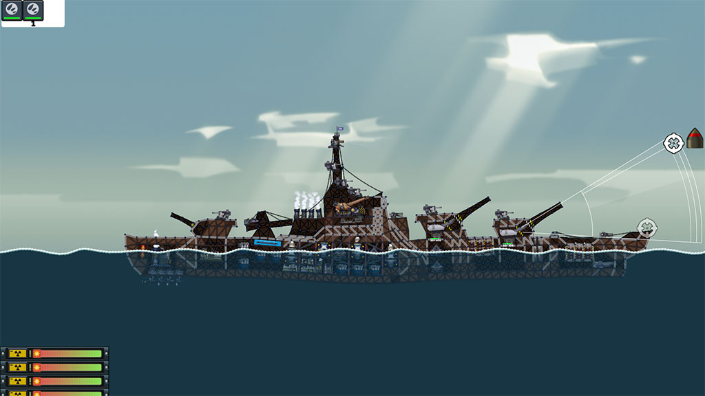

# [AOB] 浩海计划 · Age of Battleships

> 面向《进击要塞》(Forts) 的大规模海战主题模组：把原版的要塞攻防搬到大洋之上，用主炮、鱼雷、舰载机、导弹与电磁武器重建一套完整的舰队作战体系。

[](#版本信息)
[](#版本信息)
[](https://store.steampowered.com/app/410900/Forts/)
[](https://www.lua.org/)
[](https://steamcommunity.com/sharedfiles/filedetails/?id=2869755294)



---

## 目录

- [简介](#简介)
- [特色功能](#特色功能)
  - [主炮体系与弹药机制](#主炮体系与弹药机制)
  - [鱼雷、水雷与水下载具](#鱼雷水雷与水下载具)
  - [防空与末端拦截](#防空与末端拦截)
  - [航空兵](#航空兵)
  - [导弹与战略打击](#导弹与战略打击)
  - [电磁武器与能量护盾](#电磁武器与能量护盾)
  - [舰船工程与后勤](#舰船工程与后勤)
  - [作战指令（Rage Mode）](#作战指令rage-mode)
  - [建筑材料、计分板与科技树](#建筑材料计分板与科技树)
- [依赖与兼容性](#依赖与兼容性)
- [安装与使用](#安装与使用)
- [快速上手](#快速上手)
- [目录结构](#目录结构)
- [开发指南](#开发指南)
- [本地化](#本地化)
- [已知问题与开发中内容](#已知问题与开发中内容)
- [贡献指南](#贡献指南)
- [致谢](#致谢)
- [社区与视频](#社区与视频)
- [相关链接](#相关链接)
- [许可证](#许可证)

---

## 简介

**浩海计划（Age of Battleships，简称 AOB）** 是《进击要塞》的一款海战主题大型模组。模组基于游戏的 Lua 脚本 API 重写并扩展了原版的武器、装置战斗逻辑，围绕"舰船"这一核心概念组织科技树：

- 用 **重装船坞（`port`）** 代替原版科技建筑的定位，作为战舰装配与高级武器的前置；
- 用 **主炮组 + 火药库** 的组合取代"一门炮打天下"，弹药类型、弹药存量与命中角度都会影响伤害结果；
- 用 **作战指令（Rage Mode）**、**能量穹顶护盾**、**电磁武器** 等机制提供原版不具备的战术维度；
- 同时提供 **AI 参数调优**、**中英双语本地化** 以及 **十余款指挥官模组的兼容补丁**。

模组当前版本为 **V5.4.1「缓回力场护盾」**，仍在持续更新中，部分内容在模组内文案中标注为"研发中/开发中"。

## 特色功能

> 下列功能均对应仓库中的实际脚本与资源文件；括号内为对应的 `SaveName` 或 `FileName`，便于检索与二次开发。

### 主炮体系与弹药机制

- **口径递进的舰炮家族**：76 mm / 130 mm / 152 mm / 157 mm / 203 mm / 220 mm / 380 mm / 406 mm / 457 mm / 508 mm，涵盖单装、双联、三联、四联炮塔（`weapons/dzdeckgun*.lua`、`weapons/76.lua`、`weapons/130.lua`、`weapons/762.lua`）。
- **主炮与副炮切换**：大中型主炮可通过右键升级项在"主炮模式 / 副炮模式"之间切换（`*_sec` 系列，按钮 `hud-sec-calibre` / `hud-mai-calibre`）。
- **连发射击模式**：部分炮塔可在单发与连发之间切换（`*_secrl` 系列，按钮 `hud-burst` / `hud-secburst`），切换时保留装填进度（`TransferReloadProgress`）。
- **弹药库机制（Magazine）**：主炮必须建造对应的火药库才能开火，火药库需建造在提示的白框范围内。
  - `ammo_pmagazine_small`（主炮组-轻型火药库）：服务驱逐舰 / 巡洋舰主炮组；
  - `ammo_pmagazine_large`（主炮组-重型火药库）：服务战列舰主炮组；
  - 火药库被摧毁时会引发剧烈爆炸，是模组的核心博弈点之一。
- **多弹药类型**：穿甲弹 **AP**、半穿甲弹 **SAP**、高爆弹 **HE**、电磁脉冲弹 **EMP**、超重穿甲弹 **APHE-V**（重工要塞特种弹药）、空包弹（`ammo_dzdeckgun*`）。穿甲机制包含跳弹、过度击穿与提前引爆（`script.lua` 中的 `rage_*` / `dzdkgs` 弹种表，以及 `scripts/tips.lua` 的入射角提示）。

### 鱼雷、水雷与水下载具

- **"冷雨"鱼雷**：二联装 / 三联装 / 五联装 / 快速装填机版（`dzto`、`dzto1`、`dzto2`、`dzto2r`），以及增程重型发射管（`dzto3`）。
- **"匿踪者"智能水雷**：向下布设深水水雷，友军可通过、敌军通过时上浮攻击（`dzsubmine`）。
- **波塞冬级核鱼雷**、**UUV 无人潜航器**（`ammo_nudzto`、`ammo_uuv`），可搭载于增程战斗部运载器（`ammo_nodzto`）。
- **生化武器（可选联动）**：与模组 `2924814105` 联动后解锁生化鱼雷、超音速生化导弹与孢子火箭弹（`ammo_bcdzto`、`ammo_bchy`，`script.lua` 中通过 `ModActive("2924814105")` 检测）。
- **反潜手段**：深水炸弹（`dzcannon`）、深水炸弹轰炸机中队（`ammo_subp4`）、水下型 AK630m2（`uwdzmg`、`uwhdzmg`）。

### 防空与末端拦截

- **重型高射炮**（`flakold`）、**AK630m2 系列**（自动点射版 `dzmg`、进防版 `hdzmg`、水下版 `uwdzmg` / `uwhdzmg`）。
- **防空炮组全面戒备**（`dzmgcom`）：短时间内让多门防空武器协同射击，提升火力密度。
- **"繁星"末端拦截系统**（`tieqiong`）、**"裁决"重型激光拦截系统**（`cj1`）：用于拦截超音速目标与穿甲高爆弹。
- **烟幕**（`smokewall`、`ammo_smoker2`）：切断敌方防空与观瞄视线。
- 完整的防空 AI 参数调优位于 `ai/ai.lua`（拦截概率、误差、提前量等）。

### 航空兵

以"弹药即编队"的方式实现，编队从机库/船坞起飞并可升级为可操控版本（`ammo_*`）：

| 机型 | SaveName | 说明 |
| --- | --- | --- |
| "鱼鹰"鱼雷轰炸机（单机 / 中队 / 可操控） | `ammo_topl` / `ammo_topl4` / `ammo_sbtopl` / `ammo_sbtopl4` | 投掷鱼雷 |
| "苍鹰"重型轰炸机中队（含可操控版） | `ammo_nthk4` / `ammo_sbnthk4` | 投掷高爆航弹 |
| "灰熊"战略轰炸机 | `ammo_tu95` | 16 发中型炸弹 + 1 发超重型炸弹 |
| "鸬鹚"弹跳轰炸机（中队） | `ammo_refhepl6` | 弹跳航弹，面打击 |
| "鹈鹕"火箭攻击机编队 | `ammo_rcpl3` | 3 机 × 8 发火箭弹 |
| 喷气式战术攻击机 / 歼击机 | `ammo_sbrcpl` / `ammo_sbaapl` | 火箭弹 / 航炮 / 空战与拉烟 |
| 轻型燃烧弹轰炸机中队 | `ammo_lb4` | 大范围燃烧弹压制防空 |
| 深水炸弹轰炸机中队 | `ammo_subp4` | 反潜 |

### 导弹与战略打击

- **"巨浪"舰载垂直导弹发射单元**（`hjcf`）、**航天发射基地**（`hjcfspace`）与 **军事卫星地面通讯基站**（`groundstation`）。
- **"花岗岩"悬臂发射架**（`rls`）、**"黑曜石"常规反舰导弹**、**"赤霄"超音速反舰导弹**（`ammo_hypersonic`）、**玄武岩 SII 重型巡航导弹**（`ammo_cm`，带电磁护盾与俯冲滑翔）。
- **战略轨道轰炸**（`ammo_orbitalstrike`）：呼叫在轨卫星实施持续火力覆盖，弹种混装、较难拦截。
- **"赫拉克勒斯"超远程质量驱动器**（`plm1` / `plm2`）、**"曼陀罗"战略火炮**（`mtl`）、**"利奥波德 M"重型战术火炮**（`leo`）、**"要塞"城防副炮**（`defgun`）。

### 电磁武器与能量护盾

- **"银簪"轻型电磁动能炮**（`dzelc`）与 **"穿云"电磁舰炮**（`dzelch`）：极高穿深，对护盾效果有限。
- 配套弹药：穿甲弹、被帽穿甲弹（`ammo_dzelcap`、`ammo_dzelcapb`）。
- **正电子加速器**（研发中）：由蓝图 `lt`、启动单元（`lizia`）、加速单元（`lizi`）与释放单元（`lizib`）在同一水平线上串联建造，加速单元越多威力越大。
- **改进型能量穹顶发生器**（`dzshield`）：拦截中等范围内的激光与低动能弹射物；护盾血量上限较高，被击破后回复极慢，本版本主题即"缓回力场护盾"（穹顶动画定义见 `db/sprites.lua`）。

### 舰船工程与后勤

- **重装船坞**（`port`）：战舰与高级武器的前置科技建筑。
- **电力与资源**：**玲珑 2 号加固型舰载反应堆**（`hualong`）、**GT-1000 型重油引擎**（`sheng`）及其 **引擎过载** 升级（`emgsheng`，以装置掉血换取爆发性发电）、**标压蓄电池**（`exbatt`）、**资源制造仪**（`resourcegen`）。
- **装甲与损管**：**主装甲板**（`armor`）、**装甲仓库**（`cangku`）、**损坏管制小组**（`dct`，灭火 / 缩短 EMP 时间，有使用次数限制）。
- **材料体系**（`materials/building_materials.lua`）：战舰装甲（`dzar`）、防崩落内衬（`dznc`）、硬化特种钢（`hss`）及其门与背景变体；战舰装甲在大于约 45° 倾角时可跳弹。

### 作战指令（Rage Mode）

建造 **战斗指挥中枢**（`rage`）后解锁即时作战指令，每局只能选择一种且不可更改：

| 指令 | 内部名 | 冷却 |
| --- | --- | --- |
| 主炮装填 / 消耗品装填 | `mgreload` | 16 s |
| 高爆弹穿深提升 | `hepenetrarion` | 30 s |
| 主炮射程与精度提升 | `mgdistaccuracy` | 60 s |

指令通过累积"指令点"充能至 100 点后按 <kbd>F</kbd> 释放，进度条与选择面板由 `script.lua` 中的 `RageModePanel` / `InitRageUI` / `RageCool` 绘制。

### 建筑材料、计分板与科技树

- **计分板勋带**：主炮命中（`main_caliber`）、暴击（`crit`）、核心区（`citadel`）、鱼雷（`torpedo`）、火箭弹（`rocket`）、炸弹（`bomb`）、深弹（`dbomb`）、破片（`frag`）、副炮（`secondary_caliber`）等。
- **模组科技树装置**（`guide`）：在游戏内展示各武器的建造途径与使用说明（`scripts/media/tips/` 与 `string/*/tips_strings.lua`）。
- **双语提示**：`string/Chinese/tips_strings.lua` 与 `string/English/tips_strings.lua`，由 `Load()` 按 `Language()` 自动装载。

## 依赖与兼容性

| 项目 | 值 |
| --- | --- |
| 游戏 | 《进击要塞》(Forts) |
| 必需 DLC | **Moonshot**（`dlc1`）、**High Seas**（`dlc2`），见 `mod.lua` 的 `RequiresMoonshot` / `RequiresHighSeas` |
| 自动加载的关联模组 | `dlc1`、`dlc2`、`weapon_pack`、`dlc1_weapons_skirmish`、`repair_station`、`3681972117`（`mod.lua` 的 `Include`） |
| 可选联动模组 | `2924814105`（生化武器线，运行时通过 `ModActive` 检测，缺失时相关升级项自动禁用） |
| 创意工坊 ID | `2869755294` |

`mods/` 目录内置以下兼容补丁与语言包（**随主模组一同加载，无需单独订阅**）：

- 指挥官兼容：`commander-bpo-*`（Scattershot / Seep / Shockenaugh）、`commander-cf-*`（Buster / Moonshine / Phantom）、`commander-da-*`（Builder / Overclocker / Speed Demon）、`commander-ee-*`（Fireman / Heavy Weapons / Marksman）、`commander-iba-*`（Miser / Spy / Turtle）；
- 玩法与模组兼容：`dlc2_skirmish`、`weapon_pack`、`2924814105`；
- 本地化：`language-Chinese`、`language-English`。

> 兼容补丁遵循 Forts 的模组覆盖规则：补丁包内以 `mods/<目标模组ID或文件夹名>/...` 的路径提供文件，加载时覆盖对应模组的同名文件。

## 安装与使用

### 方式一：Steam 创意工坊（推荐）

1. 在《进击要塞》创意工坊订阅 [浩海计划 V5.4.1](https://steamcommunity.com/sharedfiles/filedetails/?id=2869755294)；
2. 启动游戏，确保 **Moonshot** 与 **High Seas** 两个 DLC 已安装；
3. 在 **单人 → 遭遇战 / 多人** 的模组列表中启用本模组（模组分类为 `Weapons`，优先级 `20`）。

### 方式二：本地安装（开发 / 离线）

1. 将本仓库整体放入 `<Forts 安装目录>/data/mods/` 下，文件夹名即模组 ID（本仓库为 `1daziji`）；
2. 确认目录下存在 `mod.lua`、`displayname.lua`、`script.lua`；
3. 启动游戏，在模组列表中启用。

> **提示**：`mod.lua` 中 `Include` 列出的模组需要可被游戏解析（本地或已订阅），否则可能导致加载失败。

## 快速上手

1. 建造 **重装船坞**（`port`）解锁海战科技树；
2. 建造 **主炮组** 并在提示的白色方框内配套建造 **火药库**（轻型服务驱逐舰/巡洋舰主炮，重型服务战列舰主炮）——没有火药库的主炮无法开火；
3. 用 **弹药制造厂 / 弹药箱** 为下一个开火的主炮装填所需弹种（AP / SAP / HE / EMP / APHE-V）；
4. 视战况补充 **防空**（高炮、AK630m2、繁星）、**反潜**（深水炸弹、水下防空）与 **护盾**（能量穹顶发生器）；
5. 建造 **战斗指挥中枢** 选择本局的作战指令，累积指令点后按 <kbd>F</kbd> 释放。

## 目录结构

```text
1daziji/
├── ai/                   # AI 行为参数（防空概率、射击误差、提前量等）
├── audio/               # FMOD 音频库（*.bank 及字符串表）
├── db/                   # 精灵与动画定义（护盾穹顶、HUD 元素等）
├── devices/              # 装置与弹药定义（含 ammos/、dzshield/、port/ 等子目录）
├── effects/              # 特效脚本与音效资源
├── icons/                # 建筑材料图标
├── materials/            # 建筑材料定义与贴图
├── mods/                 # 指挥官兼容补丁、玩法兼容与语言包
├── scripts/              # 脚本库（lib / tips / console / prjfunctions）与 HUD 素材
├── string/               # 提示文本本地化（Chinese / English）
├── ui/textures/          # HUD 与右键菜单贴图（context/、HUD/）
├── weapons/              # 武器定义（含各炮塔子目录与 projectile_list.lua）
├── displayname.lua       # 中英文显示名
├── itemversion.lua       # 物品版本号
├── mod.lua               # 模组元数据、依赖与加载顺序
├── publishedfileid.lua   # 创意工坊 ID
├── preview.jpg           # 创意工坊封面
├── script.lua            # 模组主脚本（运行时入口）
└── README.md
```

规模参考：约 **1,400+** 个文件、**440+** 个 Lua 脚本、**45,000+** 行 Lua 代码。

## 开发指南

本模组完全基于《进击要塞》的 Lua 脚本 API 实现，推荐在改动前阅读官方 **[Forts Scripting API](https://www.earthworkgames.com/content/docs/FortsAPI.html)** 文档（其中的 *Mod scripts* 一节描述了 `mods/<mod>/script.lua` 的加载方式，*Storing state* 一节说明了 `data` 表的序列化约束）。

### 关键约定

- **入口脚本**：`script.lua` 是模组运行时入口，行为与任务脚本一致但不受地图限制；它通过 `dofile("scripts/forts.lua")` 获取 API，再 `dofile` 引入 `scripts/lib.lua`、`scripts/tips.lua` 等本地库。
- **事件模型**：模组脚本通过事件回调与游戏交互，主要入口为 `Load`、`Update`、`OnRestart`，并大量使用 `OnDeviceCompleted`、`OnDeviceCreated`、`OnDeviceDestroyed`、`OnWeaponFired`、`OnProjectileDestroyed`、`OnControlActivated`、`OnKey`、`OnDraw` 等。
- **状态存储**：跨帧状态必须存放在 `data` 表中（游戏自动序列化以支持中途加入与回放跳转），不要在其中存放函数或与本地玩家相关的非确定性值。
- **延迟执行**：使用 `ScheduleCall(延迟秒数, 函数, 参数...)`；`scripts/lib.lua` 中的 `ApplyForce` 即为循环施力的示例。
- **HUD 与控件**：`AddSpriteControl` / `AddButtonControl` / `AddTextControl` / `ShowControl` / `SetControlText` / `SetControlAbsolutePos`；贴图与 `ButtonSprite` / `DetailSprite` 定义位于 `db/sprites.lua`、`devices/device_list.lua`、`devices/ammo_list.lua`、`weapons/weapon_list.lua`。
- **注册装备**：装置与弹药通过向 `Devices` 注册（`devices/device_list.lua`、`devices/ammo_list.lua`），武器通过 `Weapons` 注册（`weapons/weapon_list.lua`）；升级关系通过 `Upgrades` 表或 `InsertDeviceBehind` / `InsertWeaponBehind` 声明。
- **编辑器补全**：`.vscode/settings.json` 已配置 Forts API 补全库（Lua Language Server 的 `Lua.workspace.library`），便于在 VS Code 中获得 API 提示。

### 模组文件规范

| 文件 / 目录 | 作用 |
| --- | --- |
| `mod.lua` | 模组元数据：`Selectable`、`Priority`、`Category`、`RequiresMoonshot` / `RequiresHighSeas`、`Include`（依赖的其它模组） |
| `displayname.lua` | 显示名，按语言提供（`['English']` / `['Chinese']`） |
| `itemversion.lua` | 物品版本号（整数，用于版本比对） |
| `publishedfileid.lua` | 创意工坊 ID |
| `preview.jpg` | 创意工坊预览图 |
| `script.lua` | 可选；模组级脚本，模组启用后由游戏自动加载 |
| `ai/ devices/ effects/ icons/ materials/ mods/ scripts/ string/ ui/ weapons/` | 各类资源目录 |

**覆盖规则**：补丁模组只需以 `mods/<目标模组 ID 或文件夹名>/...` 的路径提供文件，即可覆盖目标模组的同名文件；本仓库 `mods/` 下的兼容补丁与语言包即采用该方式。

### 调试

- 使用 `Log(...)` 输出到游戏控制台与 `log.txt`（位于 `Forts/users/<steamid>/`）；
- `AddTextControl` + `SetControlText` 可在屏幕固定位置显示运行时变量；
- `SpawnCircle` / `SpawnLine` 适合验证坐标与弹道计算；
- 注意：任务脚本在 **Sandbox（沙盒）** 中不会运行，请使用 **遭遇战 / 多人** 模式测试；
- 提交前请移除或关闭调试输出。

## 本地化

- 提示文本：`string/Chinese/tips_strings.lua`、`string/English/tips_strings.lua`（由 `Load()` 依据 `Language()` 装载）；
- 装备名与说明：`mods/language-Chinese/`、`mods/language-English/` 下的 `weapons/strings.lua`、`devices/strings.lua`、`materials/strings.lua`，通过 `Merge(Weapon, {...})` 等方式覆盖原版字符串表；
- 显示名称：`displayname.lua` 提供 `English` / `Chinese` 两个条目。

新增文本请同时补充中英文，避免出现回退到内部 `SaveName` 的情况。

## 已知问题与开发中内容

以下内容在模组内文案中标记为"研发中 / 开发中"，其行为、数值与平衡性可能随版本变动：

- **正电子加速器**（`lt` / `lizi` / `lizia` / `lizib`）：模块化串联建造，需在同一水平线上按 **启动单元 → 加速单元 → 释放单元** 的顺序与方向搭建，释放单元至少需要 10 个加速单元激活才能发射；加速单元不超过 12 个时射出的正电子可被传送门防御；
- **"赫拉克勒斯"超远程质量驱动器**（`plm1` / `plm2`）：多载荷投送；
- **精英升级插件**：随作战指令中枢一同规划；
- **弹道预览**：`scripts/lib.lua` 中的 `DrawTrajectoryPreview` 仅对 `plm2`、`kuangdun`、`dzdeckgun1m` 等曲射武器生效。

若发现平衡性或实现问题，欢迎通过 Issue 反馈，并附上游戏版本、模组版本（`itemversion.lua`）与 `log.txt` 相关片段。

## 贡献指南

1. **提问 / 反馈**：先搜索已有 Issue，再新建 Issue，说明复现步骤、期望结果与实际结果；
2. **提交改动**：从 `main` 切出特性分支（如 `feat/new-torpedo`、`fix/shield-regen`），保持单一主题、单一提交目的；
3. **代码风格**：与现有脚本保持一致——Lua 使用 **Tab 缩进**，函数命名沿用模组既有风格（英文驼峰/下划线与中文注释混用），新增配平数值建议同时给出注释说明；
4. **新增内容**：需要同时提供 ① 武器/装置定义（`weapons/`、`devices/`）、② 对应的 `weapon_list.lua` / `device_list.lua` / `ammo_list.lua` 注册项、③ 中英文本地化、④ 图标与贴图（`ui/textures/`、`icons/`）；如涉及兼容补丁，请放在 `mods/<目标模组>/` 下；
5. **测试**：在 **遭遇战 / 多人** 模式下验证（Sandbox 不执行任务与模组脚本），确认无 Lua 报错后再提交 PR；
6. **兼容性**：修改原版机制或通用逻辑时，请回归验证 `mods/` 下的兼容补丁与语言包是否仍然可用。

## 致谢

- 感谢 **Forts** 开发团队（EarthWork Games）提供的脚本 API 与模组支持；
- 感谢模组作者与协作者：模组文案中署名的 **打字机**（主作者）、**Drige狐狼**（部分武器设计）等；
- 感谢参与兼容适配与测试的社区：**Iron Bear Alliance**、**Dragon Army**、**FYFT 战队** 等；
- 感谢所有反馈问题、提供数值建议与参与汉化/英化的玩家。

（以上署名整理自模组内的 `strings.lua` 与提示文案；如遗漏或需要更正，请提交 Issue。）

## 社区与视频

B 站搜索关键词：**`浩海计划`**、**`进击要塞 浩海计划`**。

| 视频 | UP 主 | 说明 |
| --- | --- | --- |
| [[浩海计划]--最详细的武器&机制讲解！！！](https://www.bilibili.com/video/BV1F2421c7Ao/) | — | 目前最贴题的一条机制讲解视频；截至整理时该稿件已被 UP 主设为"仅自见"，无法正常观看 |


## 相关链接

**本模组**

- Steam 创意工坊主页：<https://steamcommunity.com/sharedfiles/filedetails/?id=2869755294>
- 作者反馈渠道（见模组内文案）：QQ `2330351377`，或 B 站私信 `typewriter awa`

**游戏与官方文档**

- 《进击要塞》商店页：<https://store.steampowered.com/app/410900/Forts/>
- 官方脚本 API 参考：<https://www.earthworkgames.com/content/docs/FortsAPI.html>
  - 包含 `Basic Script Example`、`Mission scripts`、`Mod scripts`、`Storing state`、`Debugging` 等章节，以及全部脚本函数（Artificial Intelligence / Audio / Devices / Effects / HUD / Projectiles / Teams / Water …）与事件（Devices / Input / Projectiles / Structure / System …）列表。
- 官方模组制作指南 How to mod Forts：<https://steamcommunity.com/sharedfiles/filedetails/?id=1296612027>
- 中文版《Forts 模组制作指南》：<https://steamcommunity.com/sharedfiles/filedetails/?id=2335465393>

> API 文档同时提供离线版本（单文件 HTML），可保存在仓库外的任意位置离线查阅，例如 `Forts Scripting API.htm`；仓库内不包含该文档。

## 版本信息

| 字段 | 值 | 来源 |
| --- | --- | --- |
| 显示名（中文） | `[AOB]浩海计划-V5.4.1(缓回力场护盾)` | `displayname.lua` |
| 显示名（英文） | `[AOB]Age of Battleships-V5.4.1(Force shield)` | `displayname.lua` |
| 物品版本 | `1153` | `itemversion.lua` |
| 创意工坊 ID | `2869755294` | `publishedfileid.lua` |
| 模组分类 / 优先级 | `Weapons` / `20` | `mod.lua` |
| 工坊首发 | 2022-10-01 | Steam 创意工坊公开信息 |
| 工坊最近更新 | 2026-10-11 | Steam 创意工坊公开信息 |
| 订阅数 | 约 2.8 万（累计约 3.1 万） | Steam 创意工坊公开信息，随订阅变化 |
| 工坊标签 | `Mod` / `Weapon` / `Moonshot` / `High Seas` / `Nested` | Steam 创意工坊公开信息 |
| 体积 | 约 166.8 MiB（1,469 个文件） | 本仓库实测 |

## 许可证

本仓库当前执行MIT

